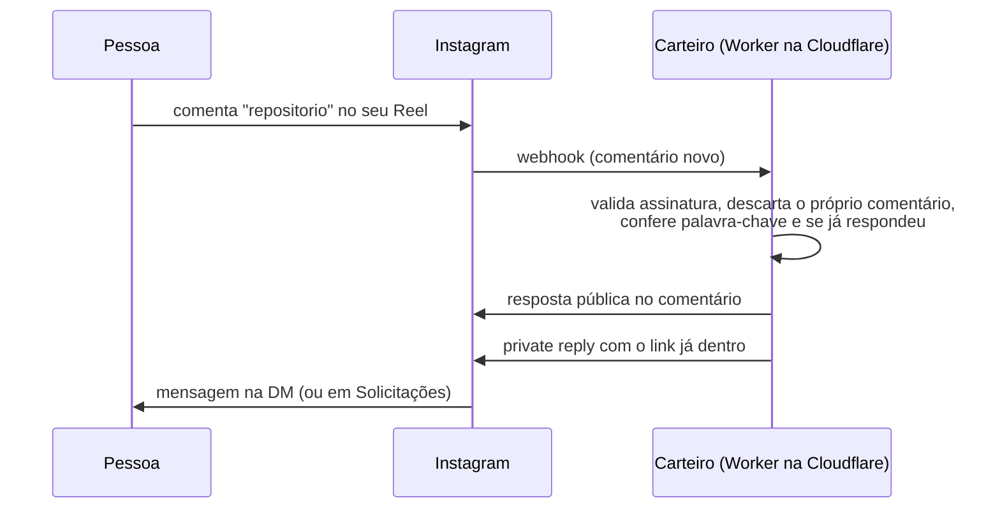

# Carteiro — comentou a palavra, recebeu o link

> Alguém comenta uma palavra-chave no seu post ou Reel e recebe **automaticamente** uma mensagem direta com o link ou material. **Sem mensalidade de ferramenta de terceiros**, dentro das regras da Meta. Aqui está o desenho e o prompt para a sua IA construir o seu.

## Resposta rápida às dúvidas mais comuns
- **A pessoa precisa me seguir para receber?** **Não.** Pela documentação oficial da Meta (*Private Replies*), quem segue recebe na Caixa de entrada; quem não segue recebe em **Solicitações de mensagem**. O link chega nos dois casos. Peça no vídeo "segue para mais novidades" como convite, não como condição.
- **Quantas mensagens posso mandar?** Uma **única** mensagem por comentário, em até **7 dias**. Só se a pessoa responder abre-se uma janela de 24 h para continuar a conversa.
- **Que conta preciso?** Instagram **profissional** (Comercial ou Criador) e pública, com **"Permitir acesso a mensagens"** ligado e, no caminho atual, uma **Página do Facebook vinculada**.
- **Preciso de aprovação da Meta?** Para **as suas próprias contas**, em modo de desenvolvimento, não. Para atender contas de terceiros, sim (verificação do negócio e revisão do app).

## Como funciona


### O fluxo correto, em 6 passos
1. O comentário chega pelo **webhook** `comments`. Se o autor é a própria conta, **descarta** (a Meta ecoa seus comentários).
2. Casa a **palavra-chave** sem acento, minúscula e tolerando erro de digitação.
3. Responde **em público** com uma frase sorteada de uma lista (evita padrão repetido).
4. Envia o **private reply com o material já dentro** (link incluído, não prometido). É texto puro, sem mídia.
5. Se a pessoa **responder**, abre-se a janela de 24 h: cabe **um** follow-up dentro dela.
6. Se **não responder**: fim. Nenhum "lembrete" depois (é fora da política da Meta).

## O que você precisa
| Peça | Custo para começar |
|---|---|
| Conta Instagram profissional + Página do Facebook vinculada | grátis |
| App no `developers.facebook.com` (modo desenvolvimento) | grátis |
| **Cloudflare Workers + D1** (recebe o webhook e guarda o estado) | plano gratuito (confira limites) |
| Telegram (alertas) | grátis |

## Configuração no painel da Meta (resumo para a IA guiar você)
1. Crie um app em `developers.facebook.com` e adicione o caso de uso **"Gerenciar mensagens e conteúdo no Instagram"**.
2. **Antes de escolher o tipo de login, leia o que a tela oferece:** apps novos usam o **Unified Login** (Facebook Login for Business com um `config_id`); o caminho "Instagram Login" é o legado e pode nem aparecer. **Esta escolha é irreversível** para o app (trocar exige app novo).
3. Permissões da fase 1 (menor privilégio): `instagram_basic`, `instagram_manage_comments`, `instagram_manage_messages`. Outras entram depois editando a mesma configuração.
4. No celular, em cada conta: ligar **Permitir acesso a mensagens** (Configurações → Mensagens e respostas de stories → Ferramentas conectadas). **Desligado, a Meta não gera nenhum evento e falha em silêncio.**
5. Webhook: campos `comments` e `messages`; a URL é a do seu Worker. Valide `X-Hub-Signature-256`.
6. Gere o token de acesso **você mesmo** e guarde em arquivo local protegido e depois como segredo do Worker. **Nunca no chat.**

## Critérios que a sua IA deve cumprir (Gate 1)
| # | Critério |
|---|---|
| 1 | QUANDO o webhook receber POST sem assinatura válida, DEVE responder 403 e não gravar nada. |
| 2 | QUANDO o autor do comentário for a própria conta, DEVE descartar. |
| 3 | QUANDO o mesmo `comment_id` chegar duas vezes, DEVE enviar no máximo **uma** resposta privada (único no banco). |
| 4 | NÃO DEVE enviar mensagem fora da janela de 24 h, exceto a resposta privada do comentário. |
| 5 | QUANDO o comentário tiver mais de 7 dias, DEVE marcar `expirado` e não enviar. |
| 6 | QUANDO a Meta responder o erro de "acesso a mensagens desligado", DEVE registrar a causa por extenso e alertar no Telegram. |
| 7 | Webhook DEVE responder 200 rápido (menos de 1 s) e processar depois. |
| 8 | QUANDO `DRY_RUN=1`, NÃO DEVE chamar nenhuma API de envio. |
| 9 | Nenhum token ou segredo DEVE aparecer em log, commit ou relatório. |

## Prompt para a sua IA construir o seu Carteiro
```text
Quero montar o "Carteiro" do ecossistema-vibecode (pasta CARTEIRO). Objetivo: quando alguém comentar a palavra "<MINHA PALAVRA>" nos meus Reels, enviar um direct com este link: <MEU LINK>.
1) Escreva o Gate 1 em .agents/propostas/G1_CARTEIRO-01.md com os critérios do README do Carteiro.
2) Use Cloudflare Workers + D1 (plano gratuito). Comece em modo simulação (DRY_RUN).
3) Me guie, passo a passo, na criação do app da Meta e no que EU preciso clicar. Nenhuma chave no chat.
4) Antes de ligar em um post com público, teste com uma segunda conta minha e me mostre o direct chegando.
5) Peça auditoria de outra IA para a validação de assinatura e a trava de duplicidade.
```

## Link que conta cliques (sugestão)
Em vez de colocar o link direto do destino, use um endereço seu que redireciona (por exemplo `seusite.com/repositorio`). Você mede os cliques e troca o destino sem mexer na automação. É uma rota no seu site, não mexe em DNS.

## Cuidados
- Contas novas ou com picos de mensagens automáticas podem ser limitadas pela plataforma: comece devagar.
- Não prometa ganhos. Seja claro no vídeo sobre o que a pessoa vai receber.
- A Meta tem limite de respostas privadas por hora; sistemas grandes devem enfileirar.
