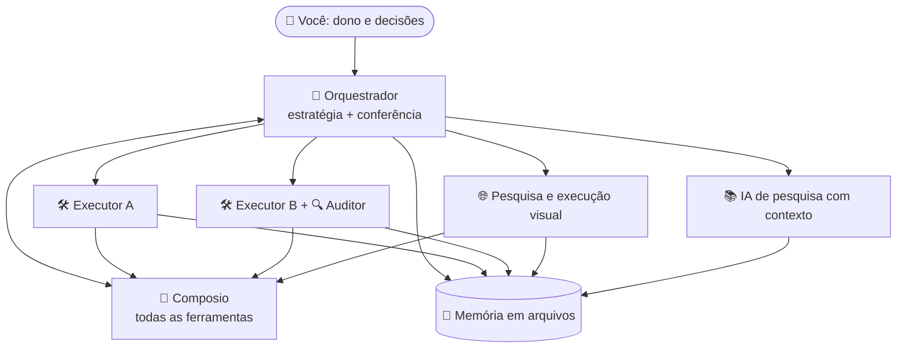

# 01 · O que é o ecossistema

## A ideia em uma frase
Você é o **dono** e o **tomador de decisão**. Um **time de IAs** faz o trabalho pesado. Um **método de prova** garante que o que as IAs dizem que fizeram foi mesmo feito. Uma **memória em arquivos** garante que nada se perde entre conversas.

## Os 4 princípios
1. **Fonte única.** Cada verdade vive em um arquivo só (o "dono"). Duas cópias da mesma coisa sempre acabam divergindo.
2. **Prova, não promessa.** IA erra, esquece e às vezes afirma o que não fez. "Pronto" significa: teste rodou, diferença de código conferida, tela testada. "Se parece bom demais, ainda não foi testado o suficiente."
3. **Autonomia com limites.** A IA decide e executa o que é pequeno e reversível. Você decide o que é irreversível ou custa dinheiro (veja [08](08-limites-e-seguranca.md)).
4. **Memória em arquivos.** A IA não lembra de ontem. Os arquivos lembram: `CHECKPOINT.md` (onde paramos), `BACKLOG.md` (o que falta), `DECISOES_ARQUITETURAIS.md` (o que já decidimos e por quê), `LESSONS_LEARNED.md` (o que já nos custou caro).

## O que você NÃO precisa saber
Programar. Você precisa saber **dizer o que quer**, **ler o resumo** que a IA entrega e **aprovar ou recusar**. O resto o método cuida.

## O que você PRECISA desenvolver (e a IA ajuda)
- Clareza sobre o que o seu produto resolve e para quem.
- Ceticismo saudável: pedir prova, desconfiar de "tudo certo".
- Hábito de registrar decisões.

## Mapa do ecossistema

