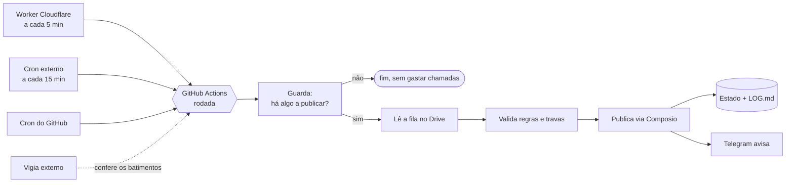

# Marquinhos — a Máquina de Posts

> Publicador automático de redes sociais que **funciona na nuvem, sem o seu computador ligado**, com travas contra erro, alertas e histórico. Nasceu no projeto `mishyo-maquina` (publicando para três contas) e este capítulo ensina a **sua IA a construir a sua**.

## O que ele faz
- Lê uma **fila de posts** (uma planilha/CSV ou pastas no Google Drive) com texto, imagens, horário e status.
- No horário certo, **publica** no Instagram, Facebook (Página), Threads, LinkedIn, Reddit e dev.to, usando as conexões do [Composio](../COMPOSIO/README.md).
- **Só publica o que você aprovou** (status `aprovado`/`agendado`). Rascunho nunca sai.
- Registra tudo em um **log** e **avisa você no Telegram** se algo falhar.

## Por que ele é confiável (as travas que aprendemos na prática)
| Problema que já nos custou caro | Trava |
|---|---|
| O agendador do GitHub é "melhor esforço" e ficou **2 dias sem disparar** | Três gatilhos independentes: um Worker na Cloudflare (a cada 5 min), um serviço de cron externo e o cron do GitHub |
| Dois disparos ao mesmo tempo **publicaram o mesmo post duas vezes** | Relê o estado **no último instante antes de publicar**; trava de concorrência no Actions; conferência por hash do conteúdo |
| Gastar as chamadas gratuitas do Composio à toa | **Guarda** que decide, sem chamar o Composio, se há algo a publicar |
| Post que sai de madrugada ou depois do horário | Janela de publicação (ex.: 07:00 a 20:00), corte noturno, silêncio na madrugada |
| Post vencido que sai muito atrasado | **Catch-up** de 3 h; depois disso vira alerta e expira |
| Site fora do ar enquanto o post aponta para ele | Trava **"site no ar"**: se o site não responde, adia sem erro |
| Dois posts da mesma conta quase juntos | Intervalo mínimo de 2 h por marca |
| Falha silenciosa | Alerta no Telegram, issue no GitHub após 3 falhas, vigia externo (heartbeat) |
| Imagem de produto com **tela preta** publicada | Verificação automática da arte (OCR) antes de aprovar |
| Um post fora da regra derrubar a rodada inteira | Post inválido é **pulado com alerta**; cada marca roda isolada |

## Como funciona (arquitetura)


## Peças
- **Fila:** `fila.csv` por marca/conta, com colunas como `quando`, `canais`, `status`, `legenda`, `hashtags`, `arquivos`.
- **Publicador:** um script (Python) que lê a fila, valida e publica.
- **Execução:** GitHub Actions (grátis para começar).
- **Gatilhos:** Worker da Cloudflare + serviço de cron externo + cron do GitHub.
- **Estado:** `estado.json` por marca, guardado de volta no Drive.
- **Alertas:** bot do Telegram (você cria com o BotFather).
- **Vigia:** serviço de heartbeat gratuito (se um batimento falta, avisa por e-mail).

## Boas práticas editoriais que ajudam
- Decida **cadência mínima** por conta (posts e stories por dia) e a **janela** de horário.
- Mistura 70% conteúdo perene e 30% assunto do momento.
- Nunca prometa o que o produto não faz. Toda peça de produto usa prints reais.
- Meça: seguidores, alcance e engajamento por post; se não crescer mês a mês, revise o método.

## Como pedir para a sua IA construir a sua
Cole na sua IA (já configurada com o ecossistema):

```text
Quero montar a minha "Máquina de Posts" seguindo o capítulo MARQUINHOS do ecossistema-vibecode.
1) Pergunte quais redes e contas eu tenho e a cadência que quero.
2) Escreva o Gate 1 (com critérios EARS) em .agents/propostas/G1_MAQUINA-01.md contendo: fila em CSV, publicador com todas as travas da tabela, gatilhos triplos, alertas no Telegram e logs.
3) Use o Composio para as conexões. Nenhuma chave no chat.
4) Comece em modo simulação (DRY_RUN) e me mostre o que publicaria antes de qualquer envio real.
5) Peça auditoria de outra IA antes de ligar o modo real.
```

## Limites e cuidados
- O Facebook **pessoal** não aceita publicação por API; use uma **Página**.
- Cada rede tem regras e limites próprios. Plataformas podem limitar contas com comportamento de robô: comece devagar e com texto natural.
- Tudo começa em **simulação**; só liga o real depois do seu "sim".
